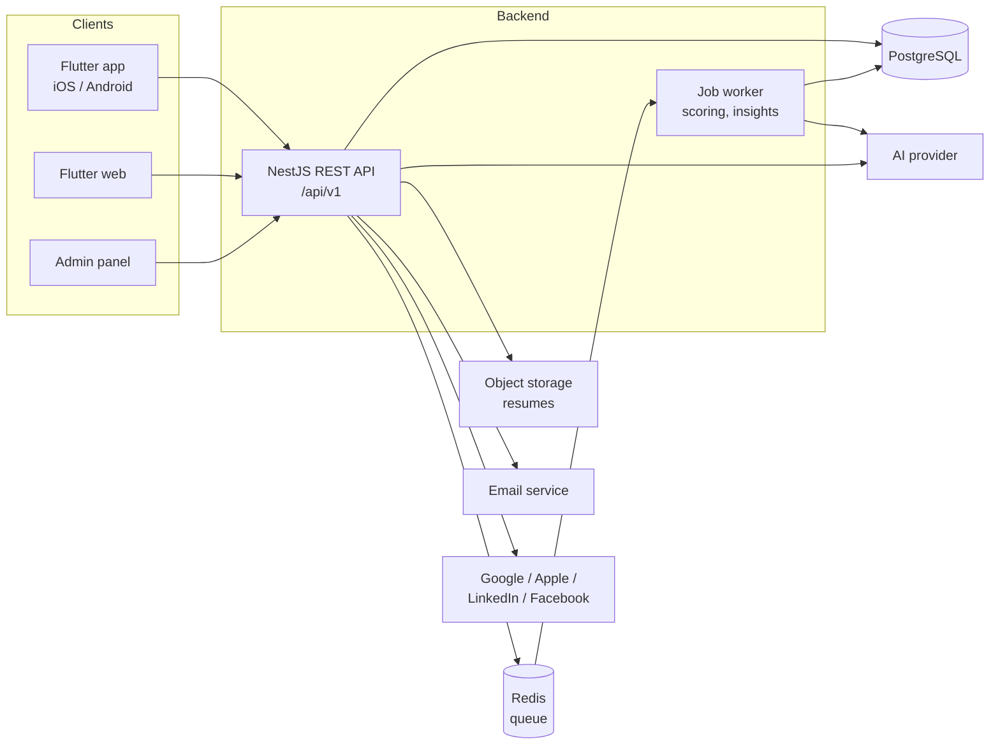
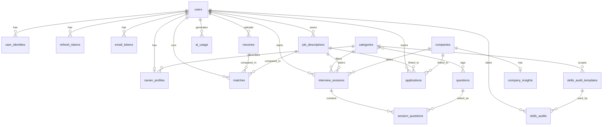
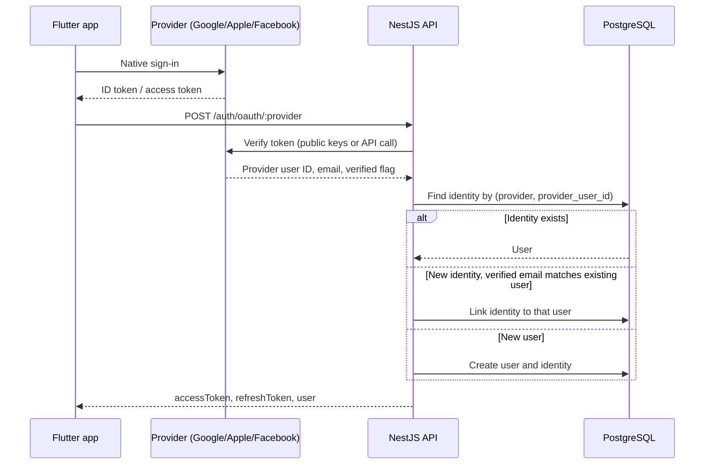
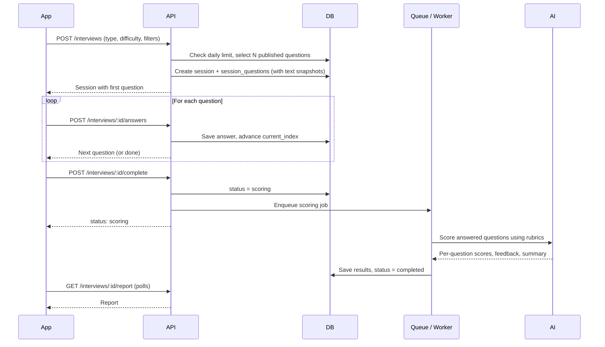

# Solstice Interview Suite — System Design Document (SDD)

**Version:** 0.2 (draft)
**Date:** October 26, 2026
**Prepared by:** Bill (backend) · **Shared with:** Joel (frontend)
**Client:** Solstice HQ (Juliet Ijere)
**Companion document:** Software Requirements Specification (SRS)

### Revision history

| Version | Date | Changes |
|---|---|---|
| 0.1 | Oct 22, 2026 | First draft |
| 0.2 | Oct 26, 2026 | Merged in the full API endpoint reference (section 9). Fixed inconsistencies between the design and the endpoints: see section 15. |

---

## 1. Purpose

This document describes how the Solstice Interview Suite v1 will be built. It covers the architecture, backend modules, data model, authentication, AI integration, key flows, the full API endpoint reference and the delivery plan.

What the system must do is defined in the SRS.

Items marked **(proposed)** are recommendations that still need team sign-off.

---

## 2. Architecture Overview



| Component | Technology | Notes |
|---|---|---|
| Mobile app | Flutter | Built by Joel |
| Web app | Flutter web | Same codebase as the mobile app |
| Admin panel | To decide: Flutter web or React | See open decisions |
| API | NestJS (TypeScript) on Node.js | Modular monolith with a single deployable |
| Database | PostgreSQL | Primary data store |
| ORM | Prisma **(proposed)** | Type-safe queries and migrations |
| Job queue | BullMQ with Redis **(proposed)** | Runs slow AI work such as interview scoring outside the request cycle. The worker can run inside the API process at first. |
| File storage | S3-compatible storage **(proposed)** | Stores uploaded resumes; the database holds only metadata and extracted text |
| AI | To be confirmed | Accessed only through the internal AI module |
| Email | Transactional email provider (to decide) | Verification and password reset emails |
| API docs | `@nestjs/swagger` | OpenAPI spec generated from the code |

**Why a modular monolith.** With one backend developer and a 10–12 week timeline, a single NestJS app split into clear modules is far simpler to build, deploy and debug than microservices. Modules talk to each other through injected services, not HTTP, so any module could be extracted later if needed.

---

## 3. Backend Module Structure

| Module | Responsibility | Depends on |
|---|---|---|
| `AuthModule` | Email/password auth, social sign-in, tokens, verification and reset | Users, Mail |
| `UsersModule` | Accounts, identities, roles, password change, account deletion | Storage |
| `CategoriesModule` | Roles and industries (user read access, admin management) | — |
| `ProfileModule` | Career profile | Users, Categories |
| `ResumesModule` | Upload, download, text extraction | Storage |
| `JobDescriptionsModule` | Saved job descriptions | — |
| `QuestionsModule` | Question bank (admin management, selection for interviews) | Categories |
| `SkillsAuditModule` | Templates (admin) and user audits | AI, Profile, Categories |
| `MatchingModule` | Resume/JD matching | AI, Resumes, Job descriptions |
| `InterviewsModule` | Sessions, answers, scoring | AI, Questions, Queue |
| `CompaniesModule` | Company search and interview insights | AI, Queue |
| `ApplicationsModule` | Application tracker | — |
| `DashboardModule` | Aggregated home screen data | All feature modules (read-only) |
| `AdminModule` | Admin users and stats endpoints | Users, feature modules |
| `AiModule` | Prompts, provider calls, response validation, usage logging | — |
| `StorageModule` | File upload, download and deletion in object storage | — |
| `MailModule` | Transactional emails | — |
| `QueueModule` | Background job setup and workers | — |

**Cross-cutting concerns** live in a shared folder:

- **Guards:** JWT authentication and role checks
- **Validation:** a global `ValidationPipe` with `class-validator` DTOs, configured with `whitelist: true` so unknown fields are stripped
- **Errors:** a global exception filter that returns the standard error shape (section 8.2)
- **Pagination:** a shared helper used by every list endpoint
- **Logging:** request logging

---

## 4. Data Model

### 4.1 Entity overview



The many-to-many link between `questions` and `categories` is stored in the `question_categories` join table.

### 4.2 Tables

Every table has `id` (UUID), `created_at` and `updated_at` unless noted otherwise.

**Accounts**

| Table | Key columns | Notes |
|---|---|---|
| `users` | `email` (nullable, unique), `email_verified`, `password_hash` (nullable), `full_name`, `avatar_url`, `role` (`user`/`admin`), `is_disabled` | Email and password are nullable for social-only accounts |
| `user_identities` | `user_id`, `provider` (`google`/`apple`/`linkedin`/`facebook`), `provider_user_id`, `email` | Unique on (`provider`, `provider_user_id`) |
| `refresh_tokens` | `user_id`, `token_hash`, `family_id`, `expires_at`, `revoked_at` | The family is used to detect reuse of a rotated token |
| `email_tokens` | `user_id`, `type` (`verify`/`reset`), `token_hash`, `expires_at`, `used_at` | Single-use tokens |
| `career_profiles` | `user_id` (unique), `target_role_category_id`, `industry_category_id`, `experience_level` (`entry`/`mid`/`senior`), `location` | One per user. Role and industry reference `categories`, so the profile can drive skills audit templates and interview question filters. |

**Documents**

| Table | Key columns | Notes |
|---|---|---|
| `resumes` | `user_id`, `title`, `storage_key`, `mime_type`, `size_bytes`, `extracted_text`, `is_default` | The file itself is kept in object storage |
| `job_descriptions` | `user_id`, `title`, `company_name`, `text` | |

**Content (admin-managed)**

| Table | Key columns | Notes |
|---|---|---|
| `categories` | `name`, `kind` (`role`/`industry`), `is_active` | Unique on (`kind`, `name`) |
| `questions` | `text`, `type` (`behavioral`/`technical`/`situational`), `difficulty` (`easy`/`medium`/`hard`), `rubric`, `model_answer`, `status` (`draft`/`published`/`archived`), `created_by` | Question type is a fixed list in code, not a category. Questions are archived, never deleted. |
| `question_categories` | `question_id`, `category_id` | Join table |
| `skills_audit_templates` | `title`, `role_category_id`, `items` (JSONB), `status` (`draft`/`published`) | `items` holds the skills or questions and the response format. At most one published template per role. |

**Feature data**

| Table | Key columns | Notes |
|---|---|---|
| `skills_audits` | `user_id`, `template_id`, `responses` (JSONB), `results` (JSONB) | Results hold strengths, gaps and recommendations |
| `matches` | `user_id`, `resume_id` (nullable), `job_description_id` (nullable), `resume_title`, `job_title`, `score`, `results` (JSONB) | Titles are copied in so history still reads well if the resume or JD is later deleted |
| `interview_sessions` | `user_id`, `type`, `difficulty`, `role_category_id`, `job_description_id`, `company_id`, `question_count`, `status`, `current_index`, `overall_score`, `summary_feedback`, `completed_at` | Status: `in_progress`, `scoring`, `completed`, `abandoned`, `failed` |
| `session_questions` | `session_id`, `question_id`, `position`, `question_text_snapshot`, `answer_text`, `answered_at`, `score`, `feedback` | The question text is copied in so reports stay accurate after admins edit a question |
| `companies` | `name`, `normalized_name` (unique), `website`, `overview` | |
| `company_insights` | `company_id` (unique), `status` (`pending`/`ready`/`failed`), `content` (JSONB), `generated_at` | Cached; refreshed when stale |
| `applications` | `user_id`, `company_name`, `role_title`, `status`, `applied_at`, `notes`, `job_description_id`, `company_id` | Status: `saved`, `applied`, `interviewing`, `offer`, `rejected` |

**Operations**

| Table | Key columns | Notes |
|---|---|---|
| `ai_usage` | `user_id` (nullable), `feature`, `input_tokens`, `output_tokens`, `latency_ms`, `created_at` | Cost tracking and monitoring. `user_id` is null for shared work such as company insights. |

### 4.3 Data rules

- Flexible AI output (results, insights, audit items) is stored as JSONB. Columns that need filtering or sorting, such as scores and statuses, stay as normal columns.
- **Deleting a user** removes all their rows (cascade delete). The service also deletes their resume files from object storage, because the database cascade can't reach those.
- **Deleting a resume or job description** doesn't delete the matches, interviews or applications that refer to it. Those references are set to null (`ON DELETE SET NULL`), and the copied titles keep the history readable.
- **Questions** are referenced by past sessions, so they are archived rather than deleted (`ON DELETE RESTRICT`).
- Every user-owned query filters by `user_id`, which is taken from the access token and never from the request body.

---

## 5. Authentication and Authorization

### 5.1 Tokens

| Token | Lifetime **(proposed)** | Storage on the client |
|---|---|---|
| Access token (JWT) | 15 minutes | In memory |
| Refresh token (opaque, random) | 30 days | `flutter_secure_storage` (Keychain on iOS, Keystore on Android) |

The access token carries `sub` (user ID) and `role`.

In v1, every client sends the refresh token in the request body, so one auth flow serves mobile, web and the admin panel. On Flutter web, secure storage falls back to browser storage, which is weaker than on mobile. Moving the web client to an httpOnly cookie is a possible later hardening step.

Refresh tokens are stored hashed and rotated on every refresh. If a token that has already been rotated is used again, the backend revokes that whole token family. This catches stolen refresh tokens.

### 5.2 Email/password rules

- A new email/password account must verify its email before it can sign in. Until then, login returns `EMAIL_NOT_VERIFIED`, and the user can request a new link through `POST /auth/resend-verification`.
- Social sign-ins whose provider reports a verified email are marked verified automatically.
- Disabled accounts can't log in or refresh (`ACCOUNT_DISABLED`). Disabling an account revokes all its refresh tokens; an access token already issued stays valid until it expires, at most 15 minutes later.

### 5.3 Social sign-in



LinkedIn follows the same pattern, except the app sends an authorization code from a browser flow, and the backend exchanges it with LinkedIn.

**Provider specifics**

| Provider | Client gets | Backend verification |
|---|---|---|
| Google | ID token | Verify the JWT signature against Google's keys. The audience must match one of our client IDs: iOS, Android and web each have their own. |
| Apple | Identity token, plus name on first sign-in only | Verify the JWT against Apple's keys. The audience is the app's bundle ID for native sign-in and the Services ID for web. Save the name on first sign-in. The email may be a private relay address. |
| Facebook | Access token | Validate the token with the Graph API and confirm it was issued to our app, then read the profile. The email may be missing. |
| LinkedIn | Authorization code (browser flow) | Exchange the code for tokens and read the OpenID Connect user info |

**Linking rule.** A new social identity is linked to an existing account only when the provider confirms the email is verified. Otherwise a new account is created.

### 5.4 Authorization

- `JwtAuthGuard` protects all non-public routes.
- `RolesGuard` with `@Roles('admin')` protects everything under `/admin/*`.
- **Ownership:** feature services always scope queries by the current user. Requesting another user's resource returns `404`, not `403`, so the response doesn't reveal that the resource exists.
- **No admin escalation through the API:** the first admin is created by a seed script, and only admins can change roles.
- **Admin safeguards:** admins can't change their own role or disable themselves, and the last remaining admin can't be demoted or disabled.

---

## 6. AI Integration

### 6.1 AI module design

Feature modules never call the AI provider directly. They call `AiService` with a task name and its inputs:

```ts
aiService.run('interview.scoreSession', { profile, questions, answers })
```

| Part | Responsibility |
|---|---|
| Prompt templates | One template per task, stored in code and versioned with it |
| Provider adapter | One interface (`AiProvider`) with an implementation per provider, so swapping providers is a config change |
| Output validation | Every task defines its expected JSON shape with a Zod schema. Invalid output is retried once, then fails cleanly. |
| Usage logging | Records tokens used and latency for every call in `ai_usage` |

### 6.2 AI tasks

| Task | Triggered by | Mode |
|---|---|---|
| `skills.evaluate` | Submitting a skills audit | Synchronous |
| `match.evaluate` | Running a resume/JD match | Synchronous |
| `interview.scoreSession` | Completing an interview | Background job |
| `company.insights` | First lookup of a company's insights, or a stale cache | Background job, cached |

Synchronous tasks have a request timeout **(proposed: 30 seconds)**. If they turn out to be too slow in practice, they can move to the job queue later.

### 6.3 Usage limits (proposed starting values)

Limits are checked when the user starts the action, so nobody finishes an interview only to be refused scoring. Each limit counts the user's records created today in that feature's own table.

| Action | Limit per user per day | Counted from |
|---|---|---|
| Mock interviews started | 5 | `interview_sessions` |
| Resume/JD matches run | 10 | `matches` |
| Skills audits submitted | 5 | `skills_audits` |

Company insights are shared and cached, so they aren't limited per user. The throttler (section 10) still protects them from abuse. Limits are tuned after launch using `ai_usage` data.

---

## 7. Key Flows

### 7.1 Mock interview



**Question selection.** The backend picks published questions at random that match the chosen type, difficulty and role category (defaulting to the user's profile role). It avoids questions the user saw in their last few sessions where possible. If not enough questions match, it relaxes the difficulty filter first, then fails with `NOT_ENOUGH_QUESTIONS`.

**State rules.** Answers are only accepted while the session is `in_progress`, and only for the current question. Anything else returns `INVALID_STATE`.

**Ending early.** A user can complete a session before answering every question, as long as at least one is answered. Only answered questions are scored. `POST /interviews/:id/abandon` ends a session without scoring.

**Failure handling.** If scoring fails after retries, the session status becomes `failed`. The answers are kept, and calling `complete` again retries scoring without redoing the interview.

### 7.2 Resume upload

1. The app sends the file to `POST /resumes` as multipart form data.
2. The API checks the type (PDF or DOCX) and size **(proposed: 5 MB maximum)**.
3. The file is stored in object storage under `resumes/{userId}/{uuid}`.
4. The text is extracted with `pdf-parse` for PDFs or `mammoth` for DOCX, and saved to `extracted_text`.
5. If no text can be extracted, for example from a scanned image PDF, the upload is still saved. The response includes a warning that matching may not work well.

Files are never exposed through public URLs. `GET /resumes/:id/file` checks ownership, then streams the file.

### 7.3 Company insights

1. Viewing insights first checks `company_insights` for that company.
2. If insights are `ready` and fresh **(proposed: under 30 days old)**, they are returned straight away.
3. Otherwise a background job is queued to generate them, and the response returns `status: "pending"`. The app polls the same endpoint until the status is `ready`.

---

## 8. API Conventions

### 8.1 General

| Item | Convention |
|---|---|
| Base path | `/api/v1` |
| Format | JSON request and response bodies; `multipart/form-data` only for file uploads |
| Auth | `Authorization: Bearer <accessToken>` |
| Roles | `user`, `admin`; admin routes live under `/api/v1/admin/*` |
| Pagination | Every list endpoint takes `?page=1&limit=20` and returns `{ data: [], meta: { page, limit, total } }` |
| Timestamps | ISO 8601, UTC |
| IDs | UUIDs |
| Async work | Returns a status field (`scoring`, `pending`) that the client polls |
| Contract | The OpenAPI spec is served at `/api/docs` in non-production environments; Joel can generate the Dart client from it |

### 8.2 Error format and codes

Every error uses the same shape:

```json
{ "code": "STRING_CODE", "message": "Human readable", "details": {} }
```

| Code | HTTP | When |
|---|---|---|
| `VALIDATION_ERROR` | 400 | Invalid request body or parameters |
| `INVALID_TOKEN` | 400 | Verification or reset token is invalid, expired or already used |
| `INVALID_CREDENTIALS` | 401 | Wrong email or password |
| `UNAUTHENTICATED` | 401 | Missing, invalid or expired access token, or an invalid refresh token |
| `EMAIL_NOT_VERIFIED` | 403 | Password login before the email is verified |
| `ACCOUNT_DISABLED` | 403 | The account has been disabled by an admin |
| `FORBIDDEN` | 403 | Signed in but not allowed (e.g. a non-admin calling `/admin`) |
| `NOT_FOUND` | 404 | Resource doesn't exist or isn't the user's |
| `CONFLICT` | 409 | Duplicate (e.g. email already registered) |
| `INVALID_STATE` | 409 | Action not allowed in the resource's current state (e.g. answering a completed interview) |
| `NOT_ENOUGH_QUESTIONS` | 422 | Not enough published questions match the interview settings |
| `RATE_LIMITED` | 429 | Too many requests in a short time (throttler) |
| `USAGE_LIMIT_REACHED` | 429 | Daily AI feature limit reached |
| `AI_UNAVAILABLE` | 503 | AI provider failed after retries |

---

## 9. API Endpoint Reference

**Access legend**

| Label | Meaning |
|---|---|
| Public | No token required |
| User | Any signed-in user |
| Admin | Signed-in user with `role = admin` |

All paths below are relative to `/api/v1`.

### 9.1 System

| Method | Path | Access | Purpose |
|---|---|---|---|
| GET | `/health` | Public | Liveness/readiness check |

### 9.2 Auth: email and password

| Method | Path | Access | Purpose | Body / notes |
|---|---|---|---|---|
| POST | `/auth/register` | Public | Create an account | `{ email, password, fullName }`; sends a verification email |
| POST | `/auth/verify-email` | Public | Confirm an email address | `{ token }` |
| POST | `/auth/resend-verification` | Public | Send a new verification email | `{ email }`; always returns 200 to avoid revealing which emails exist |
| POST | `/auth/login` | Public | Sign in | `{ email, password }` → `{ accessToken, refreshToken, user }` |
| POST | `/auth/refresh` | Public | Get a new token pair | `{ refreshToken }`; rotates the refresh token |
| POST | `/auth/logout` | Public | Revoke a refresh token | `{ refreshToken }`; public so logout still works when the access token has expired |
| POST | `/auth/forgot-password` | Public | Send a reset email | `{ email }`; always returns 200 |
| POST | `/auth/reset-password` | Public | Set a new password | `{ token, newPassword }`; revokes all the user's refresh tokens |

### 9.3 Auth: social sign-in

All four return the same `{ accessToken, refreshToken, user }` shape as email login.

| Method | Path | Access | Body | Notes |
|---|---|---|---|---|
| POST | `/auth/oauth/google` | Public | `{ idToken }` | See section 5.3 |
| POST | `/auth/oauth/apple` | Public | `{ identityToken, fullName? }` | Send `fullName` on the first sign-in, the only time Apple provides it |
| POST | `/auth/oauth/facebook` | Public | `{ accessToken }` | |
| POST | `/auth/oauth/linkedin` | Public | `{ code, redirectUri }` | Browser-based authorization-code flow |

### 9.4 Users and profile

| Method | Path | Access | Purpose | Body / notes |
|---|---|---|---|---|
| GET | `/users/me` | User | Current user | Account info, role and whether a password is set |
| PATCH | `/users/me` | User | Update account info | `{ fullName?, avatarUrl? }` |
| PATCH | `/users/me/password` | User | Change or set password | `{ currentPassword?, newPassword }`; `currentPassword` is required if a password already exists |
| DELETE | `/users/me` | User | Delete account and all data | Required by Apple's App Store rules |
| GET | `/users/me/identities` | User | List connected sign-in providers | |
| DELETE | `/users/me/identities/:provider` | User | Unlink a provider | Blocked if the user would be left with no identity and no password |
| GET | `/users/me/profile` | User | Get career profile | |
| PUT | `/users/me/profile` | User | Create or replace career profile | `{ targetRoleCategoryId, industryCategoryId?, experienceLevel, location? }` |

### 9.5 Categories

| Method | Path | Access | Purpose | Notes |
|---|---|---|---|---|
| GET | `/categories` | User | List active categories | `?kind=role` or `?kind=industry`; not paginated, since the lists are short |

### 9.6 Resumes

| Method | Path | Access | Purpose | Body / notes |
|---|---|---|---|---|
| POST | `/resumes` | User | Upload a resume | `multipart/form-data` field `file` (PDF/DOCX, max 5 MB) plus optional `title` |
| GET | `/resumes` | User | List the user's resumes | |
| GET | `/resumes/:id` | User | Get one resume | Includes extracted text |
| GET | `/resumes/:id/file` | User | Download the original file | Streams the file after an ownership check |
| PATCH | `/resumes/:id` | User | Rename or set as default | `{ title?, isDefault? }`; setting a new default clears the old one |
| DELETE | `/resumes/:id` | User | Delete a resume and its file | Past matches are kept |

### 9.7 Job descriptions

| Method | Path | Access | Purpose | Body / notes |
|---|---|---|---|---|
| POST | `/job-descriptions` | User | Save a job description | `{ title, companyName?, text }` (pasted text) |
| GET | `/job-descriptions` | User | List saved job descriptions | |
| GET | `/job-descriptions/:id` | User | Get one | |
| DELETE | `/job-descriptions/:id` | User | Delete | Linked matches, interviews and applications are kept |

### 9.8 Application tracker

| Method | Path | Access | Purpose | Body / notes |
|---|---|---|---|---|
| POST | `/applications` | User | Add an application | `{ companyName, roleTitle, status?, appliedAt?, jobDescriptionId?, companyId?, notes? }`; status defaults to `saved` |
| GET | `/applications` | User | List applications | Filter with `?status=` |
| GET | `/applications/:id` | User | Get one | |
| PATCH | `/applications/:id` | User | Edit details or change status | Any field from create, e.g. `{ status: "interviewing" }` |
| DELETE | `/applications/:id` | User | Delete | |

### 9.9 Skills audit

| Method | Path | Access | Purpose | Body / notes |
|---|---|---|---|---|
| GET | `/skills-audit/template` | User | Get the published template for a role | `?roleCategoryId=`; defaults to the user's profile role |
| POST | `/skills-audit` | User | Submit answers | `{ templateId, responses: [] }` → results with strengths, gaps and recommendations |
| GET | `/skills-audit` | User | Audit history | |
| GET | `/skills-audit/:id` | User | One audit result | |

### 9.10 Resume/JD matching

| Method | Path | Access | Purpose | Body / notes |
|---|---|---|---|---|
| POST | `/matches` | User | Run a match | `{ resumeId, jobDescriptionId }` → `{ score, matchedSkills, gaps, suggestions }` |
| GET | `/matches` | User | Match history | |
| GET | `/matches/:id` | User | One match result | |

### 9.11 Mock interviews

| Method | Path | Access | Purpose | Body / notes |
|---|---|---|---|---|
| POST | `/interviews` | User | Start a session | `{ type, difficulty, roleCategoryId?, jobDescriptionId?, companyId?, questionCount? }`; role defaults to the profile role; `questionCount` defaults to 5 **(proposed)** |
| GET | `/interviews` | User | Session history | Filter with `?status=` |
| GET | `/interviews/:id` | User | Session state | Status, progress and the current question; used to resume an unfinished session |
| POST | `/interviews/:id/answers` | User | Answer the current question | `{ questionId, answerText }` → next question, or `done: true` |
| POST | `/interviews/:id/complete` | User | End the session and score it | Allowed from `in_progress` (with at least one answer) or `failed` (retry). Returns `{ status: "scoring" }`. |
| POST | `/interviews/:id/abandon` | User | End the session without scoring | Only from `in_progress` |
| GET | `/interviews/:id/report` | User | Scores and feedback | Returns the current status until `completed`; the app polls this |

**Session statuses:** `in_progress` → `scoring` → `completed`, with `abandoned` and `failed` as side exits.

### 9.12 Company lookup

| Method | Path | Access | Purpose | Body / notes |
|---|---|---|---|---|
| GET | `/companies` | User | Search companies | `?search=` |
| GET | `/companies/:id` | User | Company overview | |
| GET | `/companies/:id/interview-insights` | User | Interview process, tips, common questions | Returns `{ status: "pending" }` while generating, then `{ status: "ready", insights }` |

How companies first get into the database depends on the data source, which is still an open decision.

### 9.13 Dashboard

| Method | Path | Access | Purpose | Notes |
|---|---|---|---|---|
| GET | `/dashboard` | User | Home screen summary in one call | Recent interviews, average scores, latest audit, latest match, application counts by status |

### 9.14 Admin: question bank

| Method | Path | Access | Purpose | Body / notes |
|---|---|---|---|---|
| GET | `/admin/questions` | Admin | List questions | Filter by `type`, `difficulty`, `status`, `roleCategoryId`, `industryCategoryId`; text search with `?search=` |
| POST | `/admin/questions` | Admin | Create a question | Fields below; starts as `draft` unless a status is given |
| GET | `/admin/questions/:id` | Admin | Get one | |
| PATCH | `/admin/questions/:id` | Admin | Edit, publish, unpublish, archive or restore | Any field below, including `status` |
| POST | `/admin/questions/import` | Admin | Bulk import from CSV | Returns the number created and row-level errors; CSV format to be defined |

There is deliberately no `DELETE`: past interview sessions reference questions, so they are archived instead.

**Question fields**

| Field | Notes |
|---|---|
| `text` | The question |
| `type` | `behavioral`, `technical`, `situational` |
| `difficulty` | `easy`, `medium`, `hard` |
| `categoryIds` | Role and industry categories |
| `rubric` | Optional; what a strong answer covers |
| `modelAnswer` | Optional; example strong answer |
| `status` | `draft`, `published`, `archived`; only `published` questions reach users |

### 9.15 Admin: categories

| Method | Path | Access | Purpose | Body / notes |
|---|---|---|---|---|
| GET | `/admin/categories` | Admin | List all, including inactive | `?kind=` |
| POST | `/admin/categories` | Admin | Create | `{ name, kind, isActive? }`; `kind` is `role` or `industry` |
| PATCH | `/admin/categories/:id` | Admin | Rename or deactivate | Deactivated categories disappear from user pickers but stay on existing records |

### 9.16 Admin: skills audit templates

| Method | Path | Access | Purpose | Notes |
|---|---|---|---|---|
| GET | `/admin/skills-audit/templates` | Admin | List templates | |
| POST | `/admin/skills-audit/templates` | Admin | Create a template | `{ title, roleCategoryId, items }` |
| GET | `/admin/skills-audit/templates/:id` | Admin | Get one | |
| PATCH | `/admin/skills-audit/templates/:id` | Admin | Edit, publish or unpublish | Publishing a template unpublishes any other published template for the same role |

### 9.17 Admin: users and stats

| Method | Path | Access | Purpose | Body / notes |
|---|---|---|---|---|
| GET | `/admin/users` | Admin | List users | `?search=` by name or email |
| PATCH | `/admin/users/:id` | Admin | Change role or disable account | `{ role?, isDisabled? }`; safeguards in section 5.4 |
| GET | `/admin/stats` | Admin | Platform overview | Signups, active users, interviews completed, average scores |

---

## 10. Security

| Area | Measure |
|---|---|
| Transport | HTTPS only |
| Passwords | Hashed with argon2 or bcrypt |
| Tokens | Short-lived access tokens; refresh tokens hashed, rotated, with reuse detection |
| Brute force | Rate limiting with `@nestjs/throttler`, strictest on auth endpoints |
| Input | DTO validation on every endpoint; unknown fields stripped |
| Files | Type and size checks; downloads only through the API after an ownership check |
| Data access | Ownership enforced in the service layer; admin routes behind the roles guard |
| Secrets | Environment variables, never committed |
| AI prompts | User text is placed only in clearly delimited input sections of prompts, and AI output is validated before it is saved or shown |

---

## 11. Environments and Deployment

| Environment | Purpose |
|---|---|
| Local | Docker Compose with PostgreSQL and Redis |
| Staging | Joel's integration target; deployed automatically from the main branch |
| Production | Live app; deployed from tagged releases |

- **Hosting:** to decide (open decision). A managed platform with PostgreSQL and Redis add-ons keeps operations light.
- **CI:** lint, unit tests and a build on every pull request; `prisma migrate deploy` runs on each deployment.
- **Configuration:** all keys and URLs come from environment variables, validated at startup with `@nestjs/config`.

---

## 12. Testing

| Level | Scope |
|---|---|
| Unit | Services: auth logic, token rotation, question selection, usage limits, interview state rules |
| Integration | Endpoints against a test database, including ownership checks and admin guards |
| AI | The AI provider is mocked in tests. Prompt changes are checked manually against a small set of sample inputs. |
| Contract | Joel builds against staging and the OpenAPI spec; breaking changes are announced before merging |

---

## 13. Delivery Plan (proposed, 12 weeks)

| Week | Backend (Bill) | Frontend (Joel), suggested |
|---|---|---|
| 1 | Project setup, conventions, CI, email/password auth | Project setup, design system, auth screens |
| 2 | Social sign-in, users, identities, categories, profile | Social sign-in, profile screens |
| 3 | Resumes, job descriptions, storage, AI module | Resume and JD screens |
| 4 | Admin question bank and category management | Admin panel start (if Flutter web) |
| 5 | Application tracker, skills audit | Tracker, skills audit screens |
| 6 | Resume/JD matching | Matching screens |
| 7–8 | Mock interviews, scoring queue | Interview flow and report screens |
| 9 | Company lookup and insights | Company screens |
| 10 | Dashboard, admin stats and users | Dashboard, remaining admin screens |
| 11 | Hardening, tests, performance, security review | Polish, error states, testing |
| 12 | Production deployment, buffer | Store submission, buffer |

Categories come in week 2 because the career profile depends on them. Staging is updated continuously, so Joel can integrate each module as soon as it lands.

---

## 14. Open Decisions

| # | Decision | Affects |
|---|---|---|
| 1 | AI provider (Solstice may already use one) | Section 6 |
| 2 | Company data source: AI-generated, an external API, or admin-curated (which may add admin company endpoints) | Sections 7.3, 9.12 |
| 3 | Admin panel technology: Flutter web or React | Sections 2, 13 |
| 4 | Interview questions bank-only, or AI follow-up questions as well | Section 7.1 |
| 5 | Hosting platform and object storage provider | Section 11 |
| 6 | Transactional email provider | Section 2 |
| 7 | Confirm Prisma and BullMQ choices | Section 2 |

---

## 15. Corrections in v0.2

These were mistakes or gaps in v0.1 and the separate API reference, fixed in this version.

| # | Problem | Fix |
|---|---|---|
| 1 | Question type existed twice: as a `type` column on questions and as a `question_type` category kind | Question type is now a fixed list in code; categories are only roles and industries |
| 2 | The career profile stored role and industry as free text, so it couldn't drive templates or question filters | Profile now references role and industry categories |
| 3 | `POST /interviews` accepted `roleCategoryId` and `questionCount`, but the sessions table had no columns for them | Columns added |
| 4 | The `failed` and `abandoned` statuses had no endpoints to reach or leave them | `complete` retries a failed session; `POST /interviews/:id/abandon` added |
| 5 | Usage limits counted completed interviews, so a user could finish an interview and then be refused scoring | Limits are checked when starting, counted from each feature's table |
| 6 | `ai_usage` only logs AI calls, so it couldn't count interview starts | `ai_usage` is now for cost tracking only |
| 7 | Logout required a valid access token, so it failed after the token expired | Logout is public and uses the refresh token |
| 8 | No way to resend a verification email, and no rule on signing in before verifying | `resend-verification` added; password login requires a verified email |
| 9 | No password change for signed-in users | `PATCH /users/me/password` added |
| 10 | Resumes were "served only through the API" but no download endpoint existed | `GET /resumes/:id/file` added |
| 11 | Deleting a resume or JD would have failed or wiped history, because matches and other records reference it | References set to null; titles copied onto matches |
| 12 | Company insights had no defined way to report "still generating" | Endpoint returns `pending` or `ready`; `status` column added |
| 13 | Unlinking a provider was blocked only by identity count, ignoring a password | Rule now counts identities and password together |
| 14 | No protection against an admin removing the last admin | Admin safeguards added |
| 15 | The web client token storage mentioned httpOnly cookies, but every endpoint expects the refresh token in the body | v1 uses body tokens everywhere; cookies noted as later hardening |
| 16 | Google and Apple audience checks didn't account for separate iOS, Android and web client IDs | Provider table updated |
| 17 | `PATCH /applications/:id/status` duplicated `PATCH /applications/:id` | Removed; status changes use the main `PATCH` |
| 18 | Questions had both a `PATCH` and a separate archive endpoint for status changes | All status changes go through `PATCH` |
| 19 | The profile (week 2) depended on categories, which weren't built until week 4 | Categories moved to week 2 |
| 20 | Error codes didn't cover unverified email, disabled accounts, rate limiting, invalid state or bad tokens | Codes added |
